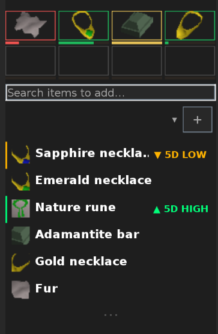
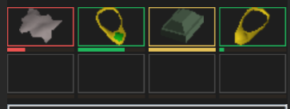
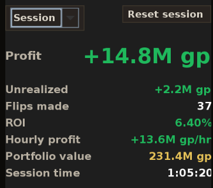
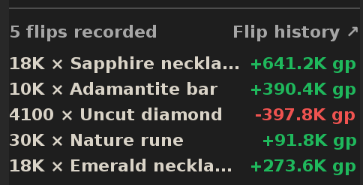

# PocketGE Trading Terminal

**Watchlists, flip ideas and trade tracking for Old School RuneScape, in your
RuneLite sidebar.**

- Free. No account. Works in free-to-play.
- Live charts one click away on [pocketge.com](https://pocketge.com).

---

## Features

### Watchlists

- Star any item into named lists, each in a colour you pick.
- Each row shows the live price and how far it is from its usual 24-hour price.
- ▲ / ▼ badges mark items at a 5-day high or low.
- Optional alerts when an item moves 10%, 15%, 20% or 30%.

### Flip ideas

- One idea at a time: buy or sell, at what price, how many, and the profit
  after tax.
- Sized to your cash, the 4-hour buy limit and what the item really trades.
- A flip score out of 100, the same one pocketge.com shows.
- The item gets a white ring in your bank, inventory or a free GE slot.
- Arrows page through the ideas. **Hold**, **Block** or **star** any of them.
- For items you own, profit is against what you actually paid.

### On the offer screen

- A ring marks what to press next: the price, then the quantity.
- A chip shows the exact number. **Press E** to fill it, or click to copy it.
- In the item search, the suggested item is the first result. Press E to pick it.
- E can be any key except Enter, Escape or Backspace (**Fill key** setting).
- The item's price chart sits over the chat. Scroll to zoom, drag to pan,
  drag the top edge to resize.
- Over the price or quantity box, the **Chart** button swaps the chart in.
- Nothing is ever confirmed for you.

### Offer slots

- Your 8 GE slots in the sidebar, each with a fill bar.
- **Grey**: working. **Yellow**: needs a new price. **Green**: ready to collect.
- The same colours outline your offers in the GE window.
- Hover a slot for its progress, what's waiting to collect, and the price to
  move to.
- Right-click a slot to stop price advice for it.
- The ▾ in the corner folds the grid away.

### Bank

- Stacks worth selling are outlined in your sell colour, the card's pick in white.
- Hover a stack for what it sells for after tax, and what you paid for it.

### Stats and history

- Profit after tax for the session, 1h, 4h, 12h, 1d, 1w, 1m or all time.
- Plus unrealized profit, ROI, gp/hour and your whole portfolio's value.
- Recent flips below. Hover one for its prices, tax and hold time.
- **Flip history** opens every flip on pocketge.com (needs the local bridge).
- Real GE tax: 2%, none under 50 gp, capped at 5M, bonds and a few tools
  exempt.
- Every flip is saved to a file on your computer.

### Find Opportunities

- Five lists: High Vol Margins, Low Vol Margins, Biggest Losers (24H),
  At 5D Highs and At 5D Lows.
- Click a row to inspect it. Right-click to chart it or add it to a watchlist.

### Free-to-play

- Hides members items and plans around 3 GE slots.

---

## Your data stays yours

- No account, no login, no telemetry.
- The only thing it contacts is the public OSRS Wiki prices API. Turn the
  advisor off and it contacts nothing; tracking keeps working.
- Wiki requests name the plugin, and pause if the Wiki asks it to slow down.
- The **local bridge** lets pocketge.com in your browser show your flips. Off
  by default, on 127.0.0.1 only, and other websites are refused.
- Flips are saved in `.runelite/pocketge-flip-tracker/flips.jsonl`.
- Watchlists, blocked items and recent flips live in RuneLite's own settings,
  so RuneLite syncs them if you're signed in to a RuneLite account.

### Honest tracking

- Reads each offer's own record of what filled, so offers it meets mid-way,
  and fills while you're logged out, still count.
- Never counts the same offer twice.
- A stack it never saw you buy shows what it sells for, never a made-up profit.

---

## Install

- RuneLite → wrench icon → **Plugin Hub** → search **PocketGE** → Install.
- Works straight away. The local bridge stays off until you turn it on.

## Settings

All in the **gear menu** at the top of the panel, and in RuneLite's wrench menu.

- **Flip advisor**: ideas and live prices. The only part that goes online.
- **Re-check every**: 5m, 30m, 2h or 8h.
- **Min. profit per suggestion**: hide small ideas.
- **Never-recommend list**, and **Ask before blocking an item**.
- **Buy / sell colours**: 8 pairs, High contrast by default, all colour-blind
  friendly.
- **Score line on cards**.
- **Watchlist badges** and **Watchlist glow borders**.
- **Alert on big price moves**: off, 10%, 15%, 20% or 30%.
- **Mark bank stacks worth selling**, **Profit on hover over stacks you
  bought** and **Show a key beside the bank**.
- **Price chart over the chat**.
- **Fill key**: E by default.
- **Chart clicks reuse your open tab** and **Open tab follows the GE offer
  screen**.
- **Local website bridge**: off by default.

## Support

- [Tip the developer](https://buy.stripe.com/aFafZg9ehaaxaVaf3e00000) through
  Stripe. Any amount helps.
- Star this repository.
- Report a problem or an idea in
  [Issues](https://github.com/grant9008/pocketge-flip-tracker/issues), or with
  the links at the bottom of the panel. A card's right-click **Copy PocketGE
  report** helps.
- In game, the only mention is a small **Support the dev** link at the bottom
  of the panel.

## Building

- Gradle needs JDK 17; the plugin targets Java 11.
- `./gradlew build` (`gradlew.bat build` on Windows).
- `PocketGeTrackerPluginTest.main()` runs a client with the plugin loaded.
- No access to `repo.runelite.net`? `./tools/typecheck/check.sh` compiles
  everything and runs the tests.

## License

[BSD 2-Clause](LICENSE)
