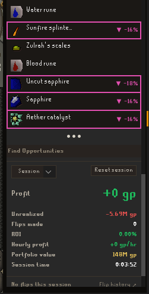
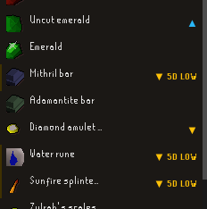
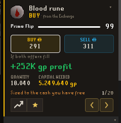
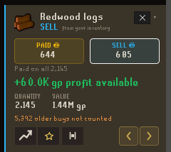
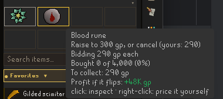

# PocketGE Trading Terminal

**Watchlists, flip ideas and trade tracking for Old School RuneScape, in your
RuneLite sidebar.**

- Free. No account. Works in free-to-play.
- Live charts one click away on [pocketge.com](https://pocketge.com).

---

## Features

### Watchlists

- Star any item into named lists, each in a colour you pick.
- Right-click a list in the list menu to rename, recolour or delete it.
- Rows flag big moves: the % when an item swings 15% or more off its usual
  24-hour price. Click a row for its price.
- **▼ 5D LOW** / **▲ 5D HIGH**: in the bottom or top 8% of its 5-day price
  range, and the row's edge glows.
- A bare **▼** or **▲**: at its 24-hour low or high.
- Lows are in your buy colour, highs in your sell colour.
- Optional alerts when an item moves 10%, 15%, 20% or 30%.

### Flip ideas

- One idea at a time: buy or sell, at what price, how many, and the profit
  after tax.
- Sized to your cash, the 4-hour buy limit and what the item really trades.
- Knows what you've bought in the last 4 hours, and won't suggest an item
  until its buy limit resets.
- A flip score out of 100, the same one pocketge.com shows.
- The item gets a white ring in your bank, inventory or a free GE slot.
- Arrows page through the ideas. **Hold**, **Block** or **star** any of them.
- For a stack it saw you buy, profit is against what you actually paid.
- Right-click any item in your bank, inventory or a GE slot: **PocketGE
  trade idea** shows it as a new flip, **PocketGE my stack** as the
  position you hold.

### On the offer screen

- A ring marks what to press next: the price, then the quantity.
- A chip shows the exact number. **Press E** to fill it, or click to copy it.
- In the item search, the suggested item is the first result. Press E to pick it.
- E can be any key except Enter, Escape or Backspace (**Fill key** setting).
- The item's price chart sits over the chat. Scroll to zoom, drag to move
  around, drag the price axis to stretch it, drag the top edge to resize.
  Double-click to reset.
- Over the price or quantity box, the **Chart** button swaps the chart in.
- Nothing is ever confirmed for you.

### Offer slots

- Your 8 GE slots in the sidebar, each with a bar that fills in your buy or
  sell colour, and turns green when the offer is done. A slot holding an
  offer sits on a grey tile; an empty one stays dark.
- A box only when a slot needs you: **white** when it needs a new price
  (white is where to act, everywhere in the plugin), **green** when it's
  ready to collect.
- Hover a slot for its progress, what's waiting to collect, what it has
  made so far, and the price to move to.
- Right-click a slot to stop price advice for it.
- The ▾ in the corner folds the grid away.

- The same boxes outline those offers in the GE window.
- A white ring marks the Buy or Sell button of a free slot, where the card's
  next trade starts.
- When a sell goes through, what it made floats up off its slot on the
  Exchange screen: **+2,000 gp** in green, or **-1,250 gp** in red on a
  loss. Sold while you were away, or with the Exchange shut? It pops the
  next time you open it, adding up everything sold since. Switch it off in
  the gear menu.

### Bank

- Stacks worth selling are outlined in your sell colour, the card's pick in white.
- Hover any stack for what it sells for after tax. One PocketGE saw you buy
  also shows what you paid and the profit or loss.

### Stats and history

- Profit after tax for the session, 1h, 4h, 12h, 1d, 1w, 1m or all time.
- Plus unrealized profit, ROI, gp/hour and your whole portfolio's value.
- Recent flips below. Hover one for its prices, tax and hold time.
- **Flip history** opens every flip on pocketge.com (needs the local bridge).
- Click **Portfolio value** for your portfolio's value over time, charted on
  the same page. It's recorded while the flip advisor is on, since it needs
  live prices.
- Real GE tax: 2%, none under 50 gp, capped at 5M, bonds and a few tools
  exempt.
- Every flip is saved to a file on your computer.

### Find Opportunities

- Five lists: High Vol Margins, Low Vol Margins, Biggest Losers (24H),
  At 5D Highs and At 5D Lows.
- Click a row to inspect it. Right-click to chart it or add it to a watchlist.

### Free-to-play

- Hides members items and plans around 3 GE slots.

---

## Your data stays yours

- No account, no login, no telemetry.
- The only thing it contacts is the public OSRS Wiki prices API. Turn the
  advisor off and it contacts nothing; tracking keeps working.
- Wiki requests name the plugin, and pause if the Wiki asks it to slow down.
- The **local bridge** lets pocketge.com in your browser show your flips,
  watchlists, bank and portfolio chart, and edit your watchlists. Off by
  default, on 127.0.0.1 only, and other websites are refused.
- Flips are saved in `.runelite/pocketge-flip-tracker/flips.jsonl`, and your
  portfolio's value every 15 minutes (with the advisor on) in
  `portfolio-*.csv` beside it.
- Watchlists, blocked items, recent flips and your last bank snapshot live in
  RuneLite's own settings, so RuneLite syncs them if you're signed in to a
  RuneLite account.

### Honest tracking

- Reads each offer's own record of what filled, so offers it meets mid-way,
  and fills while you're logged out, still count.
- Never counts the same offer twice.
- A stack it never saw you buy shows what it sells for, never a made-up profit.

---

## Install

- RuneLite → wrench icon → **Plugin Hub** → search **PocketGE** → Install.
- Works straight away. The advisor is on, so it fetches live prices from the
  OSRS Wiki.
- The local bridge stays off until you turn it on.

## Settings

All in RuneLite's wrench menu, and all but Fill key in the **gear menu** at the
top of the panel.

- **Flip advisor**: ideas and live prices. On by default; the only part that
  goes online.
- **Re-check every**: 5m, 30m, 2h or 8h.
- **Min. profit per suggestion**: hide small ideas.
- **Never-recommend list**, and **Ask before blocking an item**.
- **Buy / sell colours**: 8 pairs, High contrast by default, all readable
  with red-green colour blindness.
- **Score line on cards**.
- **Watchlist badges** and **Watchlist glow borders**.
- **Alert on big price moves**: off, 10%, 15%, 20% or 30%.
- **Mark bank stacks worth selling**, **Price and profit on hover over your
  stacks** and **Show a key beside the bank**.
- **Profit pops on GE slots**.
- **Price chart over the chat**.
- **Fill key**: E by default.
- **Chart clicks reuse your open tab** and **Open tab follows the GE offer
  screen**.
- **Local website bridge**: off by default. Switch it on to see your flips,
  bank and portfolio chart on pocketge.com.

## Support the developer

- [Tip the developer](https://buy.stripe.com/aFafZg9ehaaxaVaf3e00000) through
  Stripe. Any amount helps.
- Star this repository.
- Report a problem or an idea in
  [Issues](https://github.com/grant9008/pocketge-flip-tracker/issues), or with
  the links at the bottom of the panel. A card's right-click **Copy PocketGE
  report** helps.
- In game, the only mention is a small **Support the dev** link at the bottom
  of the panel.

## Building

- Gradle needs JDK 17; the plugin targets Java 11.
- `./gradlew build` (`gradlew.bat build` on Windows).
- `PocketGeTrackerPluginTest.main()` runs a client with the plugin loaded.
- No access to `repo.runelite.net`? `./tools/typecheck/check.sh` compiles
  everything and runs the tests.

## License

[BSD 2-Clause](LICENSE)
